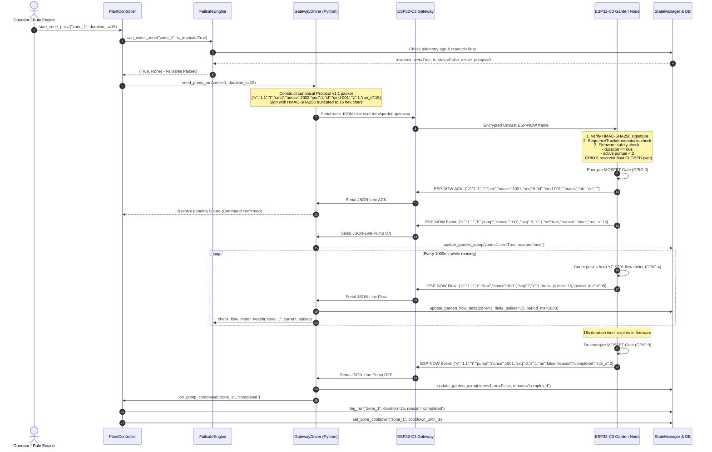

# System Architecture & Protocol Interaction

## 1. High-Level Architectural Topology

The Smart Water & Precision Irrigation Controller separates operations into two distinct physical and logical domains:

1. **Head-End Station (Rockchip RK3308, Radxa ROCK Pi S):**
   - OS: Armbian Debian 12 (Bookworm) minimal headless Linux.
   - Process Budget: Single-process asynchronous Python 3.11 runtime (FastAPI + uvicorn) strictly bound to <35 MB RAM footprint. Enforced via systemd cgroups (`MemoryHigh=128M`, `MemoryMax=200M`).
   - Hardware IO: Direct character device access via `libgpiod` (`/dev/gpiochip1`) interfacing with a 4-channel PC817 optocoupler board, hardware interlock chain, 25A AC contactor driver with auxiliary contact feedback, DS3231 I2C RTC (`/dev/i2c-7`), hardware watchdog (`/dev/watchdog`), and ALSA audio DAC (`espeak-ng`).
2. **Wireless Field Irrigation Subsystem (ESP32-C3 Super Mini):**
   - **USB Gateway:** ESP32-C3 connected via USB CDC serial (`/dev/garden-gateway` at 115200 baud). Translates USB serial JSON Lines <-> encrypted 2.4 GHz ESP-NOW frames.
   - **Garden Node:** Remote ESP32-C3 powered by solar/battery. Drives 4x 12V DC micro submersible pumps via logic-level N-MOSFETs, digitizes 4x capacitive soil probes using an ADS1115 16-bit ADC (`0x48`), reads an in-line YF-S201 Hall-effect flow meter on Zone 1 (GPIO 4), and monitors a reservoir dry-run float switch (GPIO 5).

```
+===================================================================================+
|                              HEAD-END (ROCK Pi S)                                 |
|                                                                                   |
|  [Armbian Debian 12 Bookworm]                                                     |
|   ├── Dedicated Service User 'smartwater' (MemoryMax=200M, MemoryHigh=128M)       |
|   ├── Linux Kernel Hardware Watchdog (/dev/watchdog pinged every 2s)              |
|   ├── DS3231 Precision I2C RTC (/dev/i2c-7 at 0x68)                              |
|   ├── CM108 USB Audio DAC Adapter (ALSA voice alerts via espeak-ng)               |
|   └── Single Async Python 3.11 Runtime (FastAPI + SQLite WAL + Alpine.js UI)      |
|                                                                                   |
|  [Hardware Protection Layer]                                                      |
|   ├── 4-Channel PC817 Optocoupler Isolation (Galvanic Barrier)                    |
|   │     IN1: Tank Low Float (NO)       IN2: Interlock Output Tap                  |
|   │     IN3: Interlock Midpoint Tap    IN4: Conductive Leak Sensor                |
|   └── 25A AC Contactor Driver (12V/230V coil) with NO Auxiliary Contact Feedback  |
+===================================================================================+
                                       │
                         USB Serial (/dev/garden-gateway)
                           115200 Baud, JSON Lines v1.1
                                       │
+======================================▼============================================+
|                       USB GATEWAY (ESP32-C3 Super Mini)                           |
|  - Encrypted Unicast ESP-NOW (PMK + LMK, MAC allowlisted)                        |
|  - Protocol v1.1 framing, HMAC-SHA256 signature pass-through                      |
|  - Hardware Task Watchdog (5s timeout)                                           |
+===================================================================================+
                                       │
                      2.4 GHz Encrypted Unicast ESP-NOW
                                       │
+======================================▼============================================+
|                    GARDEN IRRIGATION NODE (ESP32-C3 Super Mini)                   |
|                                                                                   |
|  - 1x ADS1115 16-Bit I2C ADC (0x48): 4x Capacitive Soil Probes (8-sample median)  |
|  - 4x Logic-Level N-MOSFETs: 12V DC Micro Submersible Drip Pumps                  |
|  - 1x Reed Float Switch: Irrigation Reservoir low-level dry cutoff (GPIO 5)       |
|  - 1x YF-S201 Hall-Effect Pulse Flow Meter on Zone 1 (GPIO 4 with 5V->3.3V divider) |
|  - Hardwired Firmware Rules:                                                      |
|      * Max 60s continuous pump pulse limit                                        |
|      * Max 2 concurrent pumps on DC bus                                           |
|      * Immediate pump cut on reservoir dry float open (GPIO 5)                    |
|      * Immediate pump cut on 60s radio link loss                                  |
+===================================================================================+
```

---

## 2. Pump Command Lifecycle & Protocol Sequence

The following sequence details an end-to-end irrigation pulse: from the trigger through failsafe checks, serial transmission, ESP-NOW delivery, acknowledgment, telemetry streaming, and run completion.



---

## 3. Dual-Layer Interlock Safety Architecture

Safety is structured in two non-negotiable layers:

```
+--------------------------------------------------------------------------+
| PHYSICAL LAYER 1: Electromechanical Hardware Interlock Chain             |
| - Passive series switches break relay module VCC directly                |
| - Full Float (NC, top of overhead tank) opens on full or severed cable   |
| - Sump Float (NO, bottom of supply well) opens on dry ground sump        |
| - ZERO code execution, zero firmware dependency                          |
+--------------------------------------------------------------------------+
                                     |
                                     v
+--------------------------------------------------------------------------+
| SOFTWARE LAYER 2: Priority 0 Hardcoded Failsafe Guardian                 |
| - Interlock cause logic & wiring fault detection (PC817 IN2 & IN3)       |
| - 15-minute continuous runtime hard stop & 30-minute cooldown            |
| - Minimum motor OFF time enforcement (120s anti-short-cycling)           |
| - Contactor auxiliary feedback pull-in (1000ms) & welded contact checks  |
| - Stale data isolation (<15s head-end, <90s garden node, <30s gateway)   |
| - Soil moisture probe sanity band filtering                              |
| - 10-second Zone 1 pulse flow verification (min_pulses_10s cutoff)      |
| - Firmware-level 60-second hardware pump cutoff on ESP32-C3 node         |
+--------------------------------------------------------------------------+
```

---

## 4. Resource Safety & Footprint Allocation

| Component | Allocation | Constraint / Strategy |
|---|---|---|
| **System RAM** | 512 MB Physical | RK3308 headless minimal installation without desktop environment or Node.js runtime |
| **Application Process** | < 35 MB Resident Set Size (RSS) | Single async process running uvicorn + FastAPI with plain h11 HTTP parsing |
| **systemd cgroup Bounds** | `MemoryHigh=128M`, `MemoryMax=200M` | Service automatically throttles if crossing 128 MB and restarts safely if exceeding 200 MB |
| **Database Memory** | ~2 MB Page Cache | SQLite WAL mode with `PRAGMA cache_size = -2000` |
| **UI Delivery** | Vanilla HTML5 + Alpine.js | Zero build step, static asset streaming, strict Content Security Policy (`'self'`) |
